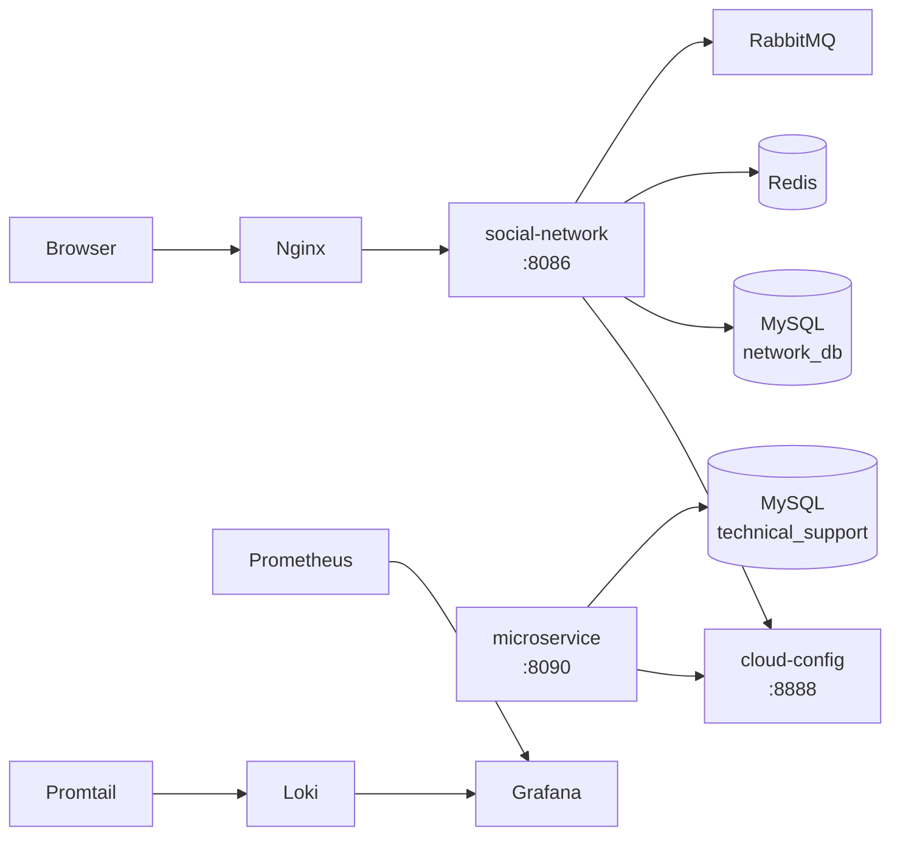

Вот README целиком, с отрисованными таблицами. Блок `mermaid` в чате показывается как код, а на GitHub он превратится в схему.

---

# social_network

A social network backend built as a set of Java microservices, with a full local infrastructure stack: Docker Compose, centralized configuration, message queues, monitoring and a CI/CD pipeline.

> Status: learning / portfolio project (originally a team project from a Java course). I am extending it with DevOps practices: see [Roadmap](#roadmap).

## Tech stack

| Area | Tools |
|---|---|
| Backend | Java, Spring (Maven), Vaadin, Socket.io |
| Architecture | Microservices, Spring Cloud Config Server |
| Data | MySQL (2 databases), Redis, Liquibase migrations |
| Messaging | RabbitMQ, AWS SQS |
| Web | Nginx (serves the static frontend, reverse proxy config in `conf.d/`) |
| Monitoring & logs | Prometheus, Grafana, Loki, Promtail |
| CI/CD | GitLab CI (build + deploy over SSH) |
| Security | Encryption of sensitive data, secrets via environment variables |
| API docs | OpenAPI (`openapi.yaml`) |

## Architecture



> TODO: verify the arrows against the real service calls (Redis, RabbitMQ, Prometheus targets).

### Services

| Service | Port | Purpose |
|---|---|---|
| `social-network` (backend) | 8086 | Main application |
| `microservice` | 8090 | Technical support service |
| `cloud-config` | 8888 | Central configuration server |
| `mysql_db_container` | 3307 | Main database |
| `mysql_microservice` | 3308 | Technical support database |
| `redis` | 6379 | Cache |
| `rabbitmq` | 5672 / 15672 | Message broker / management UI |
| `nginx` | 80 | Frontend and reverse proxy |
| `prometheus` | 9090 | Metrics |
| `grafana` | 3000 | Dashboards |
| `loki` / `promtail` | 3100 / 9080 | Log storage and shipping |

## Getting started

### Requirements

- Docker and Docker Compose
- JDK and Maven (or use the included `mvnw`)

### 1. Configure secrets

Secrets must **not** be stored in the repository. Copy the example files and fill in your own values:

```bash
cp .env.example .env
cp application.yml.example application.yml
```

Example `.env`:

```env
MYSQL_ROOT_PASSWORD=change_me
MYSQL_PASSWORD=change_me
MYSQL_MICROSERVICE_ROOT_PASSWORD=change_me
MYSQL_MICROSERVICE_PASSWORD=change_me
GRAFANA_ADMIN_USER=admin
GRAFANA_ADMIN_PASSWORD=change_me
RABBITMQ_DEFAULT_USER=admin
RABBITMQ_DEFAULT_PASS=change_me
SPRING_PROFILE=dev
```

> TODO: update `docker-compose.yml` to read these variables (`${MYSQL_ROOT_PASSWORD}` etc.) and add `.env` to `.gitignore`.

### 2. Build the services

```bash
mvn clean package -Pserver-build
```

The built `.jar` files are expected in the `jars/` directory (it is mounted into the containers).

### 3. Run

```bash
docker compose up -d
docker compose ps
```

### 4. Open

- Application: http://localhost
- Grafana: http://localhost:3000
- Prometheus: http://localhost:9090
- RabbitMQ UI: http://localhost:15672

## CI/CD

The pipeline is defined in `.gitlab-ci.yml`:

1. **build**: `mvn clean package -Pserver-build`, the `.jar` files are saved as artifacts.
2. **deploy** (branch `dev`): over SSH, stops the old containers, backs up the previous `.jar` files, uploads the new ones and runs `docker compose up -d`.

Required CI variables: `SSH_PRIVATE_KEY`, `DEV_HOST`, `DEV_USER`, `DEV_APP_PATH`.

## Roadmap

- [ ] Move all secrets out of `docker-compose.yml` into `.env`
- [ ] Add a `Dockerfile` for each service (multi-stage build, pinned base images)
- [ ] Add healthchecks and `depends_on: condition: service_healthy`
- [ ] Do not expose database and broker ports to the host
- [ ] GitHub Actions: build, tests, Trivy image scan, push to GHCR
- [ ] Nginx reverse proxy with TLS
- [ ] Infrastructure as code: Terraform + Ansible, deploy to AWS
- [ ] Automated database backups

## Project structure

```
.
├── social-network/        # main backend service
├── microservice/          # technical support service
├── zero-cloud-config/     # configuration server
├── conf.d/                # Nginx configuration
├── scripts/               # Prometheus, Loki, Promtail, Grafana configs
├── docker-compose.yml
├── .gitlab-ci.yml
├── openapi.yaml
└── application.yml.example
```

## License

TODO: add a license (for example MIT).

---

Чтобы скопировать в репозиторий, берите файл `README.md` из моего прошлого сообщения. Копирование из отрисованного текста в чате может потерять форматирование таблиц и блоков кода.
